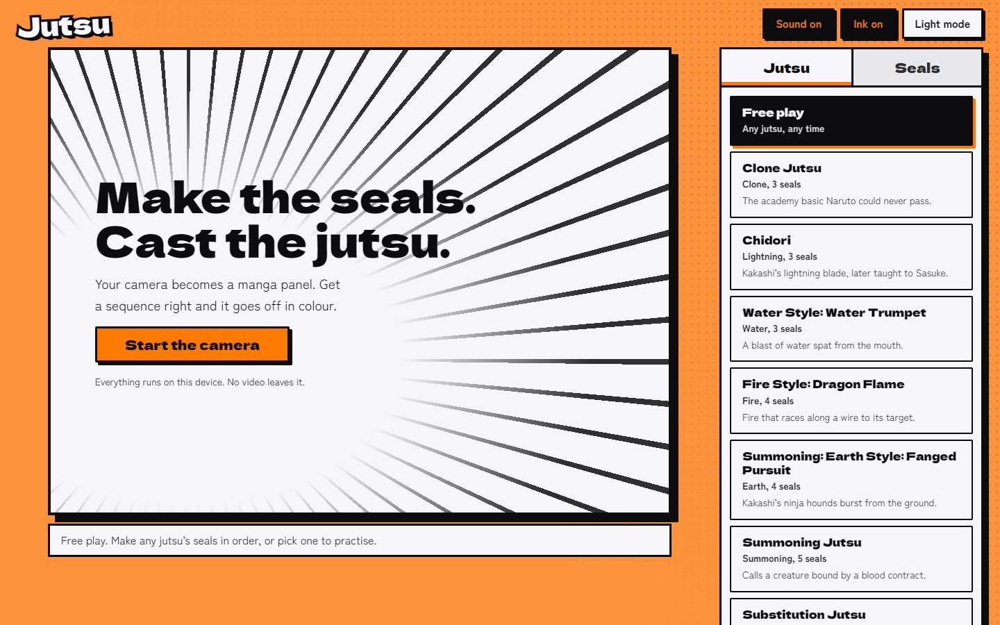
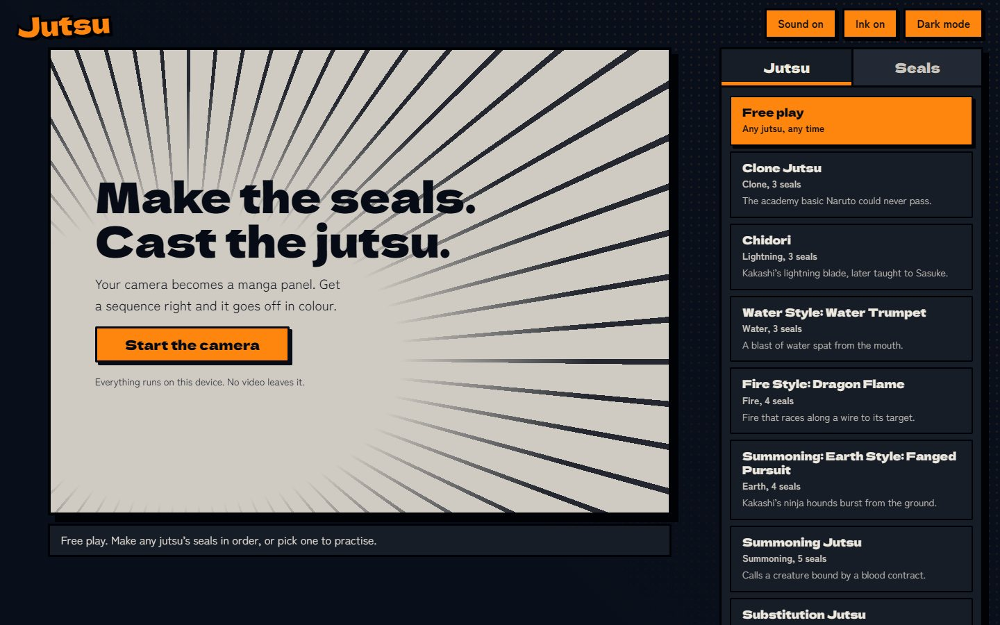
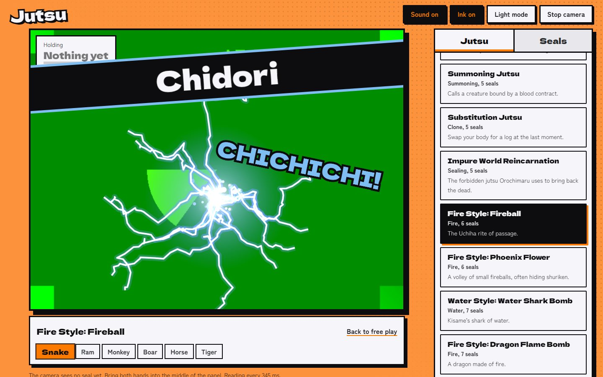

# Jutsu

Make Naruto hand seals at your webcam and cast the jutsu. Your camera is drawn live as a manga panel; get a sequence of seals right and the jutsu goes off in colour, with its effect, its name on a title card and a sound.

**Live:** https://kalpkj.github.io/jutsu/

| Light | Dark |
| --- | --- |
|  |  |



## What it does

- **Recognises 13 hand seals**: the twelve zodiac seals and the clap, including the interlocked ones that hand-tracking libraries lose.
- **13 jutsu with their seal orders from the series**, from Chidori (3 seals) to the Reaper Death Seal (10). Free play casts any jutsu whose seals you make in order; practice mode walks you through one, seal by seal, and ignores wrong seals.
- **A manga panel of your camera**: a WebGL shader inks the feed with solid shadows, paper highlights, a screentone and edge lines. A cast floods it with colour for about three seconds.
- **An effect per element**: a fireball, Chidori's arcs, a water spiral, summoning smoke, a sealing formula and ghost copies of you for the Clone Jutsu, with speed lines, an impact frame, a manga sound word and a synthesised sound.
- **A seal guide** that lights up the seal the camera sees and keeps a photo of your hands, or a pixel-art version of it, once it recognises a seal. Photos stay in your browser.
- **Light and dark modes**, and support for reduced motion.

Everything runs on your device. No video leaves your computer.

## How it works

1. **Detection.** Each camera frame is letterboxed to 416 × 416 and run through YOLOX-Nano, an object detector that treats both hands together as one shape, so interlocked fingers are part of what it learned rather than something to untangle. It runs in a Web Worker with ONNX Runtime Web (WebAssembly), one frame in flight at a time, so the page never stutters. `src/yolox.ts` ports the reference pre- and post-processing (decoding and non-maximum suppression).
2. **Seals.** `src/sequence.ts` turns noisy per-frame guesses into seals: a seal counts once it is held for 3 frames at 60% confidence or more, is never counted twice in a row, and the chain resets after 4 seconds without a new seal.
3. **Jutsu.** The same module matches the chain against the jutsu list. A test checks that no jutsu is hidden inside another, so free play can never cast the wrong one midway.
4. **The stage.** `src/stage/` holds the manga shader (WebGL2), the effects (Canvas 2D particles, procedural lightning and the sealing formula) and the sounds (Web Audio, no audio files).

The model's Mizunoe class is ignored, as it is too easily confused with Dog.

## Run it

```bash
npm install
npm run dev      # http://localhost:5173
npm test         # 20 tests, including one that runs the real model in Node
npm run build    # static site in dist/
```

## Credits and licence

- **Seal detection:** the YOLOX-Nano model from [NARUTO-HandSignDetection](https://github.com/Kazuhito00/NARUTO-HandSignDetection) by Kazuhito Takahashi, trained on 10,026 images, MIT licence. The model file and its licence are in `public/models/`.
- **Seal pictures** in the guide link to [Narutopedia](https://naruto.fandom.com/wiki/Hand_Seal).
- **Typefaces:** Dela Gothic One and Zen Kaku Gothic New, SIL Open Font License.
- **Animation guide:** `docs/effects-guide.html` is a Procreate guide for hand-drawn versions of the effects.

The code is MIT licensed (see `LICENSE`).

A fan project. Naruto belongs to Masashi Kishimoto, Shueisha and Studio Pierrot; this project is not affiliated with them and uses none of the show's artwork.
